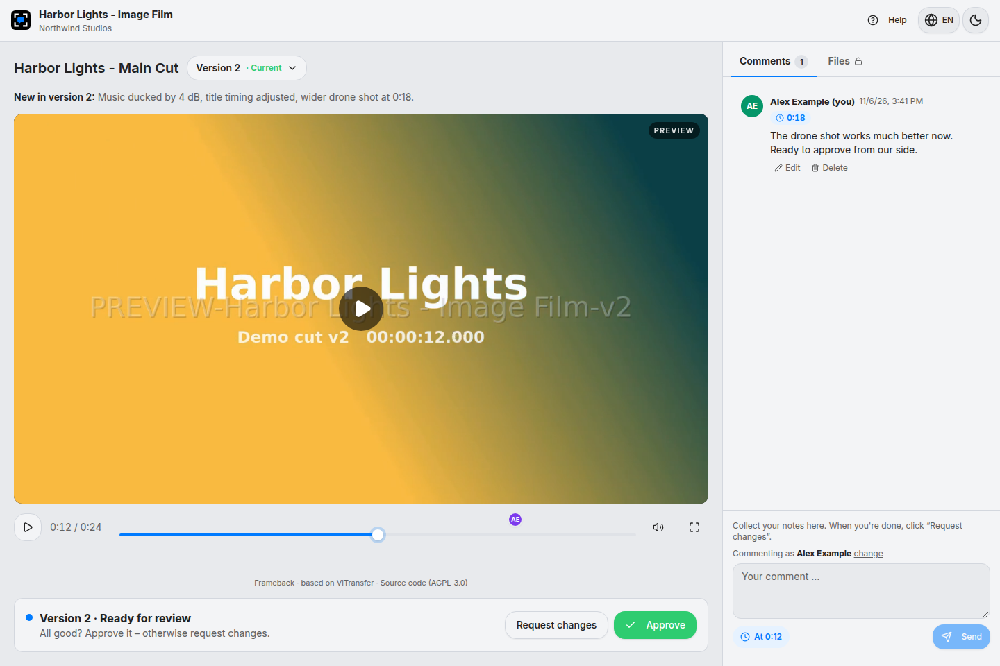
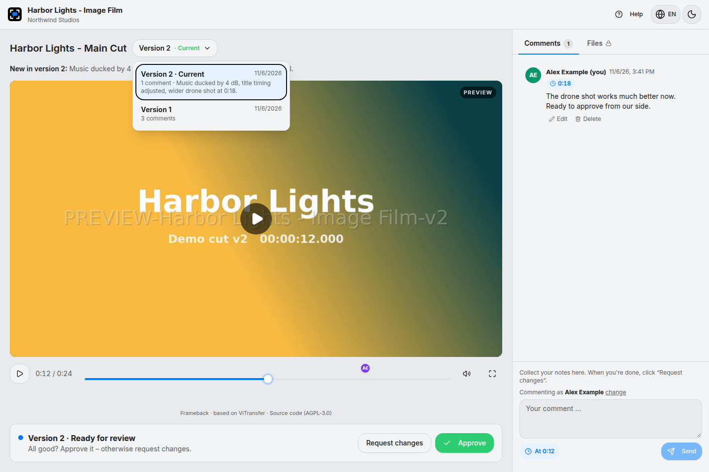
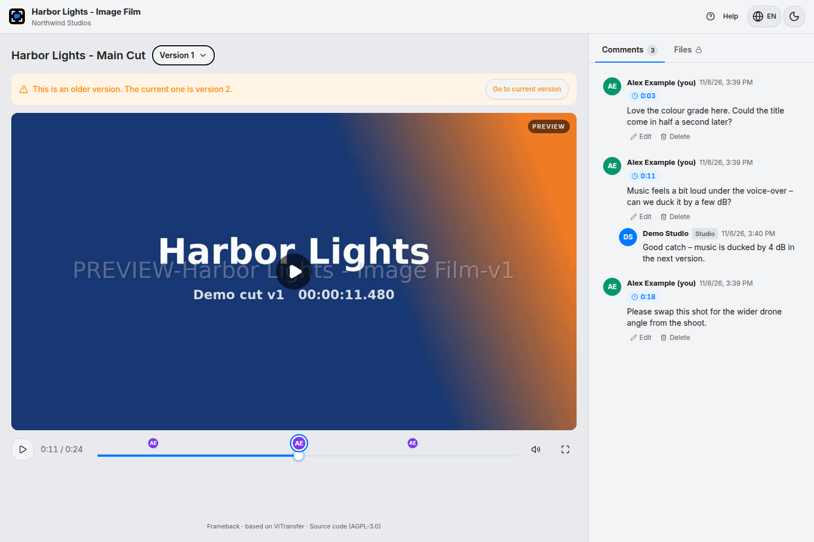
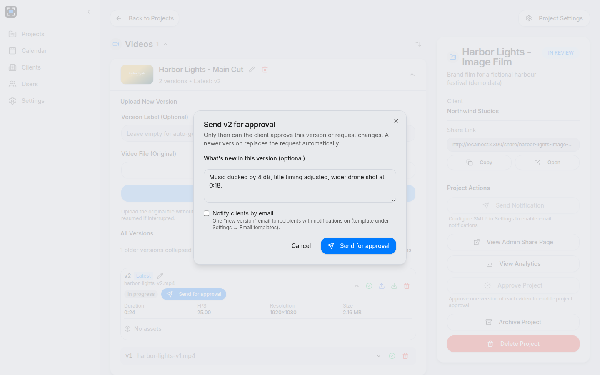
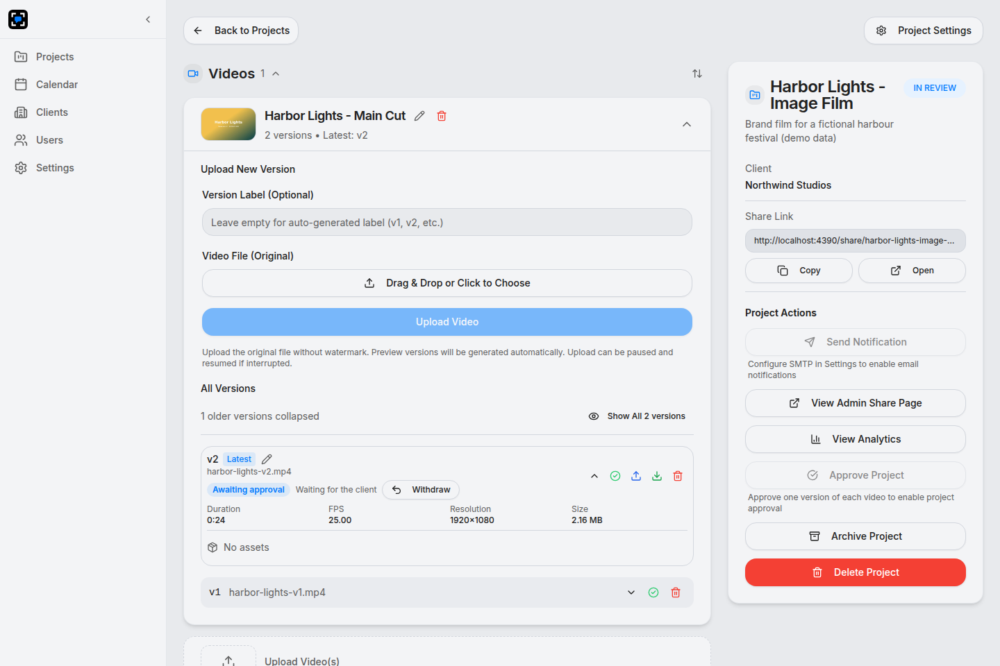
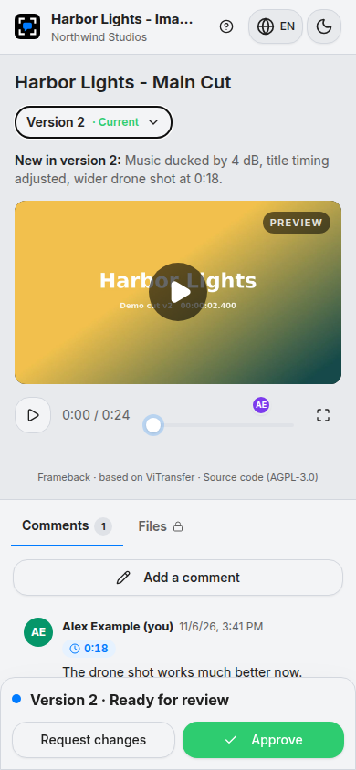

<p align="center">
  
</p>

<h1 align="center">Frameback</h1>

<p align="center">
  <strong>Self-hosted video review and approval for filmmakers and their clients.</strong><br>
  A fork of <a href="https://github.com/MansiVisuals/ViTransfer">ViTransfer</a> with a redesigned client review experience.
</p>

<p align="center">
  <a href="LICENSE"></a>
  <a href="https://github.com/MansiVisuals/ViTransfer"></a>
</p>

<p align="center">
  
</p>

---

## Why this fork

Clients told us that the review page was hard to navigate. They often weren't sure which version was current, where to find files, how to switch between videos, or whether they had approved something by accident. They also couldn't fix a typo in a comment they had posted. Frameback rebuilds the client side around these problems and keeps everything else that makes ViTransfer good: self-hosting, share links without accounts, watermarked previews, resumable uploads and transcoding.

### For clients (share link, no account)

- **The current version is always obvious.** A version picker labels the current cut, shows its comment count and the studio's "what's new" note. Older versions get a clear banner with a jump back to the current one.
- **Comments right on the timeline.** Timestamped comments appear as markers on the timeline. Click a marker to jump to the moment, or click a comment to seek the player.
- **Edit and delete your own comments** from any device, just by using the same name. No codes, no e-mail, no sign-up.
- **No accidental approvals.** Clients can approve or request changes only on a version the studio has explicitly sent for approval, and only on the current one.
- **Files in one place.** Downloads and assets live in a "Files" tab, unlocked after approval.
- **Optional reply e-mails.** A client may leave an address to hear back when the studio replies to *their own* comments. It's throttled, capped per day, and has a one-click unsubscribe.
- Works on phones and in portrait. English and German.

### For the studio

- **"Send for approval"** per version, with an optional note and an optional notification e-mail. Uploading a newer version replaces the open request automatically.
- **Audit trail** for every decision (sent, approved, changes requested, withdrawn, overridden).
- Studio replies are threaded under the client's comment and marked as such.
- Compatible with [resolve-studio-mcp](https://github.com/nielsfranke/resolve-studio-mcp) (upload from DaVinci Resolve, pull comments back into the timeline).

<table>
  <tr>
    <td width="50%"><br><sub>Version picker with comment counts and change notes</sub></td>
    <td width="50%"><br><sub>Older version: clear banner, comment thread with studio reply</sub></td>
  </tr>
  <tr>
    <td><br><sub>Studio: send a version for approval</sub></td>
    <td><br><sub>Studio: versions and review state</sub></td>
  </tr>
</table>

<p align="center"></p>

<sub>Screenshots use synthetic demo footage and fictional names.</sub>

## Status

Frameback runs in production for a small studio. New behaviour ships behind feature flags, so you can upgrade first and switch features on later:

| Variable | Default | Effect |
|---|---|---|
| `FEATURE_NEW_SHARE` | `false` | New client review page |
| `FEATURE_REVIEW_FLOW` | `false` | Clients can approve only versions the studio sent for approval |

Still planned: a studio-side redesign with folders and a client portal, a thumbnail picker that grabs the frame at the player position, and more Resolve integration.

## Quick start

There is no published image yet, so build it from source:

```bash
git clone https://github.com/nielsfranke/frameback.git
cd frameback
docker build -t frameback:local .

cp .env.example .env          # fill in the secrets (see comments in the file)
cat >> .env <<'EOF'
FRAMEBACK_IMAGE=frameback:local
NEXT_PUBLIC_APP_URL=https://review.example.com
FEATURE_NEW_SHARE=true
FEATURE_REVIEW_FLOW=true
EOF

docker compose -p frameback --env-file .env -f deploy/prod/docker-compose.yml up -d
```

The app is published on `APP_PORT`. Put it behind a reverse proxy with TLS. For a quick local test without TLS, use `NEXT_PUBLIC_APP_URL=http://localhost:<APP_PORT>` and `HTTPS_ENABLED=false`.

### Coming from ViTransfer

Frameback uses the same database and storage layout. All its migrations are additive, so existing projects, comments and **share links keep working**. Keep your `ENCRYPTION_KEY`, because stored share passwords and SMTP credentials are encrypted with it. Take a database backup first. [`scripts/cutover/cutover.sh`](scripts/cutover/cutover.sh) is the script we used to move a live instance with about a minute of downtime and automatic rollback. Read it before you use it, because it is written for our setup.

## Development

```bash
npm ci
npm run dev                   # needs Postgres + Redis, see .env.example
npm test                      # unit + integration tests (integration needs a test DB)
npm run lint
```

The design plan and decisions are in [`docs/redesign/PLAN.md`](docs/redesign/PLAN.md). The upstream documentation in [`docs/wiki`](docs/wiki/) still applies to everything Frameback didn't change.

## License and credits

Frameback is licensed under the [GNU AGPL-3.0](LICENSE), like ViTransfer. If you run a modified version as a network service, you must offer its source to your users. Every Frameback page links to the source code. Set `NEXT_PUBLIC_SOURCE_CODE_URL` if you host your own fork.

Built on [ViTransfer](https://github.com/MansiVisuals/ViTransfer) by MansiVisuals. If you want the original, stable project, use it, and consider [supporting it on Ko-fi](https://ko-fi.com/E1E215DBM4).

Developed with AI assistance (Claude, Codex), with tests and review for every change.
